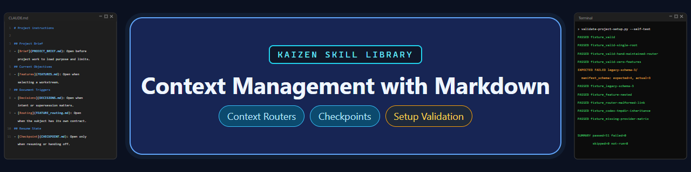

# Context Management with Markdown Agent Skill for Claude Code and Codex



> [!WARNING]
> **Work in progress.** This skill is incomplete. A custom harness, or plugins that use current frontier context-management approaches, will serve a project better than Markdown-based context management like this. Use this skill to learn the pattern or where a plugin-free setup is required.

Gives Claude Code, Codex and other coding agents 5 references, 12 templates and a setup validator for plugin-free project context in VS Code: short `CLAUDE.md` and `AGENTS.md` routers whose lines say when to open each document, feature, decision and checkpoint files, recovery after compaction, single-root or split-root workspaces, separate Claude and Codex access and temp folders, and an optional Windows launcher. The validator checks the files an agent emits against an explicit setup manifest; it does not generate a project or change provider settings.

**Status: work in progress.** The references, templates and validator are in place, with 14 activation cases; task evaluations are not written yet.

## Install

```sh
npx skills add LevyBytes/AI-SKILL-context-management-with-markdown -g
```

This installs the skill as `context-management-with-markdown` for each coding agent it finds on your computer; without `-g` it goes into the current project only. The command needs Node.js 22.20 or later.

<details>
<summary>Install without Node.js</summary>

Clone the repository into your agent's skills folder:

| Agent | Command |
| --- | --- |
| Claude Code | `git clone https://github.com/LevyBytes/AI-SKILL-context-management-with-markdown ~/.claude/skills/context-management-with-markdown` |
| Codex | `git clone https://github.com/LevyBytes/AI-SKILL-context-management-with-markdown ~/.agents/skills/context-management-with-markdown` |

</details>

## Use

Ask your agent about project context for Claude Code and Codex as usual; it loads the skill when a task matches. You can also call it by name with `/context-management-with-markdown` in Claude Code or `$context-management-with-markdown` in Codex.

- "Set up a short CLAUDE.md and AGENTS.md for this repository that route to a features index, decisions and one current checkpoint."
- "What should the checkpoint hold so the agent can resume safely after compaction?"
- "Make a split-root VS Code workspace where the project context and the source repository are separate roots, with separate temp folders for Claude and Codex."
- "Validate this project's context setup against its manifest."

## What's inside

| Reference | Covers |
| --- | --- |
| [Context management](references/context-management.md) | One authoritative layer per kind of fact, router lines that say when to open a target and what it holds, generated versus hand-maintained routers, splitting a subject into its own `FEATURE_<subject>.md`, decisions with dates and supersession, one actionable checkpoint, compaction and resume, stale-context checks |
| [Workspace and access](references/workspace-and-access.md) | Single-root or split-root topology, the VS Code workspace file and terminal root, LF editor defaults, separate Claude and Codex access matrices and temp roots |
| [Folder layout](references/folder-layout.md) | Declaring context, evidence, deliverable and temp folders in the manifest without imposing a fixed tree |
| [Windows launcher](references/windows-launcher.md) | An optional BOM-less LF CMD launcher that resolves the workspace and finds VS Code without changing the persistent PATH |
| [Validation](references/validation.md) | Preparing a setup manifest, running the validator, its status classes, and the bounded positive and negative fixtures of `--self-test` |

The assets folder holds templates for the [router](assets/context-router.md.template), features index, feature subject, decisions, checkpoint, setup manifests, single-root and split-root workspace files, Claude settings, Codex configuration and the launcher. The validator needs Python 3.12 or newer and only reads files during normal validation. The launcher profile targets Windows CMD; the context and workspace guidance does not depend on an operating system.

## When agents load this skill

Use when creating, restructuring or validating plugin-free project context and VS Code initialization for Claude Code and Codex, including concise AGENTS.md and CLAUDE.md routing, semantic feature, decision and checkpoint files, single-root or split-root workspaces, provider-specific access and temp roots, project folder and artifact-routing standards, context freshness and an optional Windows launcher; not for ordinary documentation edits, merely opening a workspace, source implementation, provider installation, skill deployment or publication.

## The work behind the references

The package separates portable rules from project choices: context authority, workspace order, provider roots, temp locations, router ownership, LF text defaults and launcher behavior all come from an explicit manifest. The public default is a single repository with an empty `project.name_prefix`; a nonempty value is leading text that an initializing agent prepends, while the manifest records the resulting names and paths. Expanded feature documents follow the fixed `FEATURE_<subject>.md` convention beside `FEATURES.md`. The validator's self-test runs 51 checks over valid and deliberately broken fixtures, such as an old manifest schema, a nested feature document, a malformed router link and a Codex temp folder inherited from the environment.

## Contributing

Pull requests are accepted from approved contributors only. To propose a fix or a feature, first open an issue that describes the change your pull request would make, such as a manifest field the validator rejects wrongly or a Claude Code or Codex setting that changed, and the documentation or tested behavior it should match. The maintainer reviews the issue and your GitHub account, then approves or declines. New maintainers are approved the same way. See [CONTRIBUTING](.github/CONTRIBUTING.md).

## Sources and license

Skill reference documentation is interpreted content for use in open source projects. Check against [official documentation sources](https://agentskills.io/specification) when dealing with defects or issues that may come up from interpreting this skill's references.

Licensed under **Apache-2.0**; see [LICENSE](LICENSE). Part of the [Agent Kaizen](https://github.com/LevyBytes/agent-kaizen) skill library.
