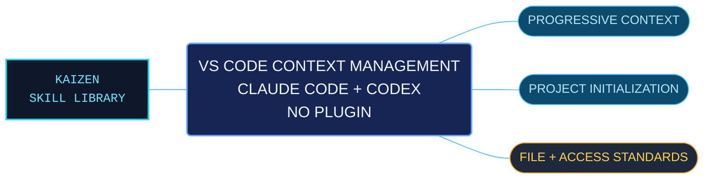

# VS Code Context Management for Claude Code and Codex (No Plugin)

Build a clean, plugin-free foundation for AI-assisted VS Code projects: concise progressive-disclosure context for Claude Code and Codex, durable feature, decision and checkpoint records, predictable project files and folders, explicit access and temporary-storage boundaries, and validated single-root or split-root initialization.

Use when creating, restructuring or validating plugin-free project context and VS Code initialization for Claude Code and Codex, including concise AGENTS.md and CLAUDE.md routing, semantic feature, decision and checkpoint files, single-root or split-root workspaces, provider-specific access and temp roots, project folder and artifact-routing standards, context freshness and an optional Windows launcher; not for ordinary documentation edits, merely opening a workspace, source implementation, provider installation, skill deployment or publication.

## What this skill helps with

- [Context management](references/context-management.md): design thin shared or provider-specific routers, organize semantic feature and decision records, preserve a complete current checkpoint, and recover safely after compaction.
- [Workspace and access](references/workspace-and-access.md): initialize a single-root or split-root workspace with project identity, an explicit terminal root, LF editor defaults and independent Claude and Codex access.
- [Folder layout](references/folder-layout.md): declare context, evidence, deliverable and temp paths without imposing a fixed prefix or universal tree.
- [Windows launcher](references/windows-launcher.md): optionally emit a BOM-less LF launcher without persistent PATH mutation.
- [Validation](references/validation.md): strictly parse setup inputs and exercise bounded positive and negative fixtures.

## The work behind the references

The package separates portable invariants from project choices: context authority, workspace order, provider roots, temp locations, router ownership, LF text defaults and optional launcher behavior all come from an explicit manifest. The public default is a single repository with an empty `project.name_prefix`; Kaizen and other custom profiles use the same schema and must explicitly provide any nonempty prefix, split roots, folders, denials and tool settings. Reusable assets guide agent-performed initialization, while the deterministic validator checks emitted project files without launching the editor or modifying provider state.

## Start here

Start with [SKILL.md](SKILL.md) and follow its context routes.

No context-management plugin or background service is required. The bundled validator requires Python 3.12 or newer and is read-only during normal validation; it is not a standalone setup generator. The context and workspace guidance is topology-neutral, and the optional launcher profile targets Windows CMD with BOM-less UTF-8 and LF line endings.

## Sources and license

Skill reference documentation is interpreted content for use in open source projects. Check against [official documentation sources](https://agentskills.io/specification) when dealing with defects or issues that may come up from interpreting this skill's references.

Licensed under **Apache-2.0**; see [LICENSE](LICENSE). Part of the [Agent Kaizen](https://github.com/LevyBytes/agent-kaizen) skill library.
